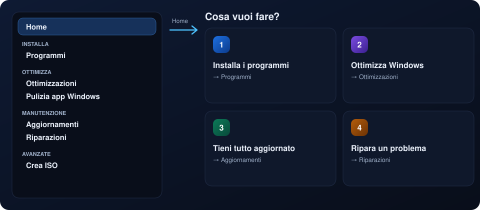
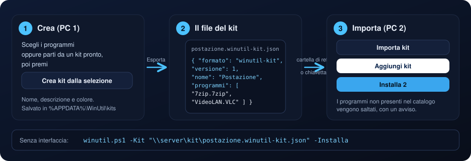

# WinUtil – interfaccia ridisegnata (fork personale)

[English](README.md) | **Italiano**


Questo è un fork personale di [ChrisTitusTech/winutil](https://github.com/ChrisTitusTech/winutil) con un'interfaccia ridisegnata, opzionale. **Non** è il progetto ufficiale e non è affiliato ad esso. Installazioni, ottimizzazioni e aggiornamenti usano ancora il motore di upstream: quella logica non è stata cambiata.

## Cosa cambia, e perché esiste il fork

La finestra di upstream è un lungo elenco di caselle con nomi asciutti e una colonna di pulsanti in inglese. Questo fork aggiunge una seconda interfaccia, più leggibile e più sicura per chi è alle prime armi con questo tipo di strumento:

- **Una barra laterale a gruppi**: Home, *Installa* (Programmi), *Ottimizza* (Ottimizzazioni, Pulizia app Windows), *Manutenzione* (Aggiornamenti, Riparazioni), *Avanzate* (Crea ISO), e una pagina **Home**, "Cosa vuoi fare?", con quattro scelte numerate.
- **Una scheda Programmi ridisegnata**: ricerca, **kit** pronti, filtri per categoria con contatori, una scheda per programma con la sua icona vera, un pannello di dettaglio e una barra azioni flottante con la selezione, Installa e l'avanzamento.
- **Kit personalizzati**: salvi una selezione come kit, la esporti in un file (anche su una cartella di rete), la importi su un altro PC, oppure la installi senza finestra: `-Kit "kit.winutil-kit.json" -Installa`.
- **Ottimizzazioni spiegate in parole semplici**, con il pannello "Prima di applicare", dalla versione precedente di questo fork.
- **Italiano e inglese**, selezionabili dalla barra laterale; testi che seguono lo scaling dei caratteri di WinUtil (Ctrl +/-), controlli di almeno 44 px e focus da tastiera visibile nella nuova finestra.

Resta compatibile con upstream. L'interfaccia originale è ancora la build predefinita; il ridisegno è opzionale. I file di upstream sono stati lasciati intatti per quanto possibile (la nuova build aggiunge i suoi pezzi in fase di compilazione), così integrare gli aggiornamenti di upstream resta semplice.

## Come installare e avviare

> **L'unico comando per questo fork** (WinUtil chiede di rilanciarsi come Amministratore):
>
> ```powershell
> irm https://github.com/realfulvio/winutil/releases/latest/download/winutil.ps1 | iex
> ```

Scarica l'ultima build dell'interfaccia ridisegnata di questo fork (pubblicata dal workflow [Release redesigned interface](.github/workflows/redesign-release.yaml)) e, quando si rilancia come Amministratore, riscarica quella stessa build, non quella di upstream. Per compilarla da sé (Windows, PowerShell e Git):

```powershell
git clone https://github.com/realfulvio/winutil.git
cd winutil
.\Compile.ps1 -Interface Redesign -Run
```

`Compile.ps1` costruisce `winutil.ps1` dai sorgenti (il file è generato e non viene salvato nel repository). Se PowerShell si rifiuta di eseguirlo, consenti gli script solo per questa finestra con `Set-ExecutionPolicy -Scope Process -ExecutionPolicy Bypass`.

## Schermate

> Sono immagini della finestra del programma vero (la build compilata, in esecuzione su una macchina virtuale Windows 11, disegnata a 1280 x 820), non bozzetti. Le icone che vedi sono quelle che il programma ha scaricato o disegna da sé. Italiano a sinistra, inglese a destra.

### Home e navigazione

| Italiano | English |
|---|---|
|  |  |



### Programmi

Scegli un kit o clicca i programmi uno per uno; la barra in basso conta la selezione e la installa. Il filtro "Installati" e l'etichetta su ogni scheda mostrano cosa c'è già sul PC (letto dal gestore pacchetti in uso).

| Italiano | English |
|---|---|
|  |  |

Il pulsante ⓘ di una scheda apre il dettaglio a destra: descrizione, categoria, gli ID WinGet e Chocolatey, licenza (quando il catalogo segna il programma come open source), sito web e il pulsante che lo aggiunge o lo toglie dalla selezione.

| Italiano | English |
|---|---|
|  |  |

Durante l'installazione la barra mostra il passo che il motore riporta e una percentuale (il testo del passo arriva dal motore, in inglese):

| Italiano | English |
|---|---|
|  |  |

Il menu "⋯" contiene ciò che prima era una colonna fissa: disinstalla la selezione, aggiorna tutti i programmi, seleziona gli installati e la scelta tra WinGet e Chocolatey.

### Icone

Ogni programma mostra la propria icona. In quest'ordine: l'icona che la **pagina web ufficiale** del programma dichiara (scaricata in background in `%LOCALAPPDATA%\WinUtil\icons`, senza mai bloccare la finestra, e mostrata da quella cache quando manca la rete); un **profilo di marchio** di [Simple Icons](https://simpleicons.org/) (CC0) su una tessera del colore del marchio; un **glifo generico della categoria**. Fonti e licenze sono in [docs/ICONS.md](docs/ICONS.md).

### Ottimizzazioni

La scheda Ottimizzazioni, con schede, filtri e pannello "Prima di applicare", ora dentro la barra laterale a gruppi.

| Italiano | English |
|---|---|
|  |  |
|  |  |
|  |  |
|  |  |

*Consigliata* significa che l'ottimizzazione è nel preset Standard di upstream; *Avanzato* significa che è nella categoria "CAUTION" di upstream o che è una modifica rischiosa di per sé. Se si può annullare lo si legge dai dati dell'ottimizzazione stessa, non è scritto a mano. Interruttori, pulsanti e l'elenco Multiplane Overlay si applicano subito come in upstream e compaiono in "Altre impostazioni"; l'elenco DNS si applica con il pulsante Applica.

## Kit personalizzati

Un **kit** è un elenco di programmi con un nome. Tre sono inclusi in WinUtil (Ufficio, Sviluppo, Gaming); puoi crearne di tuoi e portarli da un PC all'altro.



| Italiano | English |
|---|---|
|  |  |
|  |  |

- **Aggiungi kit** mette i programmi del kit nella selezione; "✓ Aggiunto" li toglie di nuovo.
- **Crea kit dalla selezione**: un nome (obbligatorio), una descrizione (facoltativa), uno di cinque colori. Viene salvato in `%APPDATA%\WinUtil\kits` e compare tra i kit con l'etichetta *Personalizzato*, più i pulsanti **Esporta** ed **Elimina**.
- **Esporta** chiede dove salvare `nome.winutil-kit.json` (va bene anche una cartella di rete). **Importa kit** legge un file così, lo controlla e aggiunge il kit; i programmi che il catalogo non ha vengono saltati e il messaggio dice quanti.

Il file contiene **ID dei pacchetti**, mai i nomi visualizzati, quindi significa la stessa cosa su ogni PC:

```json
{
  "formato": "winutil-kit",
  "versione": 1,
  "nome": "Postazione Ufficio Tributi",
  "descrizione": "App standard per il front-office",
  "programmi": [
    "7zip.7zip",
    "VideoLAN.VLC",
    "Mozilla.Firefox"
  ]
}
```

L'ID è quello WinGet del programma, oppure quello Chocolatey quando non ne ha uno WinGet; un kit fatto su un PC con un catalogo più recente si importa comunque qui.

### Installare un kit da riga di comando

Per le postazioni, senza finestra. Il comando vale per la build ridisegnata e richiede `winutil.ps1` come file (scaricalo dalle [release](https://github.com/realfulvio/winutil/releases/latest) o compilalo):

```powershell
# Mostra cosa contiene il kit e cosa verrebbe saltato. Non installa nulla.
powershell -ExecutionPolicy Bypass -File .\winutil.ps1 -Kit "\\server\kit\ufficio.winutil-kit.json"

# Lo installa in silenzio, un programma alla volta, poi riferisce
powershell -ExecutionPolicy Bypass -File .\winutil.ps1 -Kit "\\server\kit\ufficio.winutil-kit.json" -Installa
```

Si rilancia come Amministratore se serve (richiesta UAC) e aspetta il risultato. Codice di uscita **0** = riuscito, **1** = kit non leggibile o installazione con problemi, **2** = `-Installa` senza `-Kit`. I messaggi sono nella lingua di Windows. Il gestore pacchetti è WinGet. Il registro è in `%LOCALAPPDATA%\winutil\logs`.

## Cosa è cambiato

- `ui/redesign/`: la nuova finestra, i suoi stili, il dizionario (`strings.json`), gli extra del catalogo programmi (`programs.json`), i profili dei marchi (`icons.json`) e il codice di esecuzione. Vedi [SPEC.md](SPEC.md) e la pagina di architettura della documentazione.
- `Compile.ps1`: l'opzione `-Interface Redesign` (la build predefinita non cambia). La build ridisegnata riceve anche i parametri `-Kit` e `-Installa`, aggiunti in fase di compilazione.
- Funzioni di upstream "avvolte": `Initialize-WinUtilTabContent`, `Find-TweaksByNameOrDescription`, `Invoke-WinUtilFontScaling`, `Find-AppsByNameOrDescription` e `Invoke-WPFTab` (la versione di upstream si chiama `<Nome>Upstream` e fa ancora il lavoro).
- Installa, disinstalla e aggiorna sono i pulsanti e le funzioni di upstream, comandati dalla nuova finestra.

## Stato del progetto

Verificato in questa versione, su una macchina virtuale Windows 11 Enterprise LTSC con Windows PowerShell 5.1, con la build ridisegnata compilata:

- La finestra vera è stata pilotata attraverso i suoi controlli veri (63 controlli, tutti superati): Home e le sue quattro card, la barra laterale, il catalogo (236 schede), i filtri per categoria, la ricerca, la selezione, la barra azioni, i tre kit predefiniti, il pannello di dettaglio, creazione, salvataggio, esportazione, importazione ed eliminazione di un kit personalizzato, i file kit non validi o con programmi sconosciuti, il menu del gestore pacchetti e il cambio italiano/inglese. Nessun errore registrato.
- **7-Zip e VLC sono stati davvero installati e poi disinstallati con WinGet** dalla finestra (24 controlli, tutti superati), compreso l'avanzamento, l'aggiornamento dei segni "Installato" e il catalogo disabilitato mentre un lavoro è in corso.
- La modalità da riga di comando (15 controlli, tutti superati): una prova a vuoto, un kit non valido e uno mancante, `-Installa` senza kit e un'installazione vera di un kit con un programma sconosciuto.
- Icone: 202 schede su 236 mostrano l'icona del programma scaricata dal suo sito ufficiale, 15 un profilo di marchio e 19 il glifo della categoria; con la rete irraggiungibile le stesse 202 si vedono dalla cache, e una rete assente non ha segnato nessun programma come privo di icona.
- `Compile.ps1` compila entrambe le varianti e lo script ridisegnato si legge senza errori; i nuovi test Pester (kit, icone, adattatore) passano. L'intera suite su Windows PowerShell 5.1 dà 928 superati e 11 falliti; gli 11 sono i test WinOneShot di upstream, che usano `ConvertFrom-Json -NoEnumerate` (solo PowerShell 7) e non c'entrano con questa modifica.

Non verificato: il percorso Chocolatey da capo a fondo (solo il passaggio a esso), PowerShell 7 sulla macchina di prova (i runner Windows di GitHub hanno eseguito l'intera suite su PowerShell 7 per questa versione: 939 test superati, 0 falliti), altre versioni di Windows, schermi ad alta densità e altre dimensioni di finestra, le vere finestre Apri/Salva di Esporta e Importa (le stesse funzioni sono state eseguite con percorsi espliciti), la finestra di conferma di upstream per Disinstalla (risposta dal test) e Applica/Annulla della scheda Ottimizzazioni in questa versione (erano stati provati su un PC vero nella versione precedente, su due ottimizzazioni di registro a livello utente). Le ottimizzazioni che eseguono script, fermano servizi o scrivono in `HKLM`, e il punto di ripristino, non sono mai state provate con l'interfaccia. Le schermate sono immagini della finestra fatte dal programma in esecuzione, non catture di un desktop. I dettagli sono in [`NOTE-LAVORO.md`](NOTE-LAVORO.md).

## Tornare all'interfaccia originale

> **Il comando di upstream, non di questo fork.** Avvia WinUtil ufficiale, non modificato:
>
> ```powershell
> irm https://christitus.com/win | iex
> ```

Oppure compila questo repository senza l'opzione: `.\Compile.ps1 -Run`.

## Avvertenza

**Ottimizzazioni e installazioni modificano il sistema**: registro, servizi, componenti e programmi installati. Non tutte le modifiche si possono annullare e alcune richiedono un riavvio. Crea un **punto di ripristino** prima di applicare qualsiasi cosa (lo fa l'ottimizzazione *Punto di ripristino*) e leggi prima ogni descrizione. **Lo usi a tuo rischio**; il software è fornito così com'è, senza garanzie.

## Crediti e licenza

Il motore, le ottimizzazioni, l'elenco delle app e l'interfaccia originale sono opera di **[Chris Titus Tech](https://github.com/ChrisTitusTech)** e dei collaboratori di [ChrisTitusTech/winutil](https://github.com/ChrisTitusTech/winutil); vedi i suoi [collaboratori](https://github.com/ChrisTitusTech/winutil/graphs/contributors) e la [documentazione ufficiale](https://winutil.christitus.com/). Questo fork mantiene la licenza di upstream: [MIT](LICENSE), copyright (c) 2022 CT Tech Group LLC. Nomi e loghi dei marchi appartengono ai rispettivi proprietari; vedi [docs/ICONS.md](docs/ICONS.md).
