# WinUtil – redesigned interface (personal fork)

**English** | [Italiano](README.it.md)

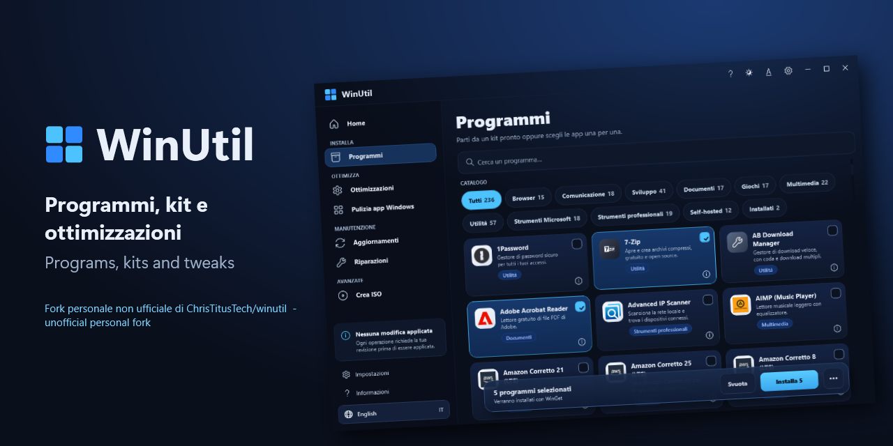

This is a personal fork of [ChrisTitusTech/winutil](https://github.com/ChrisTitusTech/winutil) with an optional, redesigned interface. It is **not** the official project and is not affiliated with it. Installs, tweaks and updates still run on upstream's engine: that logic was not changed.

## What changes, and why the fork exists

Upstream's window is a long list of terse checkboxes and a column of English buttons. This fork adds a second interface that is easier to read and safer for people who are new to this kind of tool:

- **A sidebar in groups**: Home, *Install* (Programs), *Optimize* (Tweaks, Windows app cleanup), *Maintenance* (Updates, Repair), *Advanced* (Create ISO), and a **Home** page, "What do you want to do?", with four numbered choices.
- **A redesigned Programs tab**: search, ready-made **kits**, category chips with counters, one card per program with its real icon, a details panel, and a floating action bar with the selection, Install and the progress.
- **Custom kits**: save a selection as a kit, export it to a file (a network folder works), import it on another PC, or install it with no window at all: `-Kit "kit.winutil-kit.json" -Installa`.
- **Tweaks explained in plain words** with a "Before you apply" panel, from the earlier release of this fork.
- **Italian and English**, switchable from the sidebar; text that follows WinUtil's font scaling (Ctrl +/-), controls of at least 44 px and visible keyboard focus in the new window.

It stays compatible with upstream. The original interface is still the default build; the redesign is opt-in. Upstream's files were left alone as far as possible (the new build adds its pieces at compile time), so merging upstream updates stays simple.

## Install and run

> **The one command for this fork** (WinUtil asks to relaunch itself as Administrator):
>
> ```powershell
> irm https://github.com/realfulvio/winutil/releases/latest/download/winutil.ps1 | iex
> ```

It downloads the latest build of this fork's redesigned interface (published by the [Release redesigned interface](.github/workflows/redesign-release.yaml) workflow) and, when it relaunches as Administrator, downloads that same build again, not upstream's. To build it yourself (Windows, PowerShell and Git):

```powershell
git clone https://github.com/realfulvio/winutil.git
cd winutil
.\Compile.ps1 -Interface Redesign -Run
```

`Compile.ps1` builds `winutil.ps1` from the sources (the file is generated and is not committed). If PowerShell refuses to run it, allow scripts for this window only with `Set-ExecutionPolicy -Scope Process -ExecutionPolicy Bypass`.

## Screenshots

> They are renders of the real program's window (the compiled build, running on a Windows 11 virtual machine, drawn at 1280 x 820), not mock-ups. The icons you see are the ones the program downloaded or draws itself. Italian on the left, English on the right.

### Home and navigation

| Italiano | English |
|---|---|
| 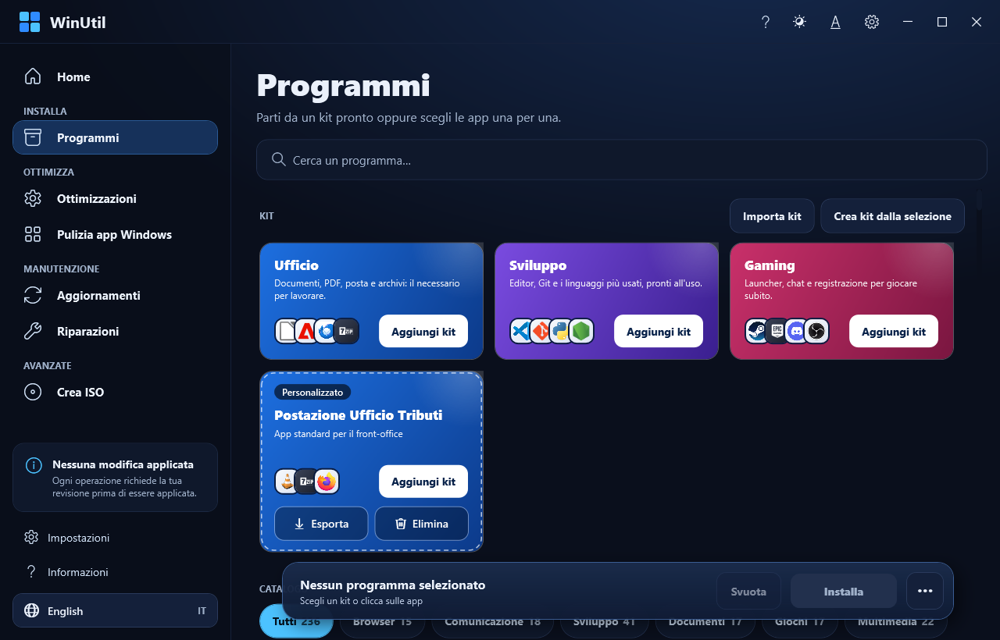 | 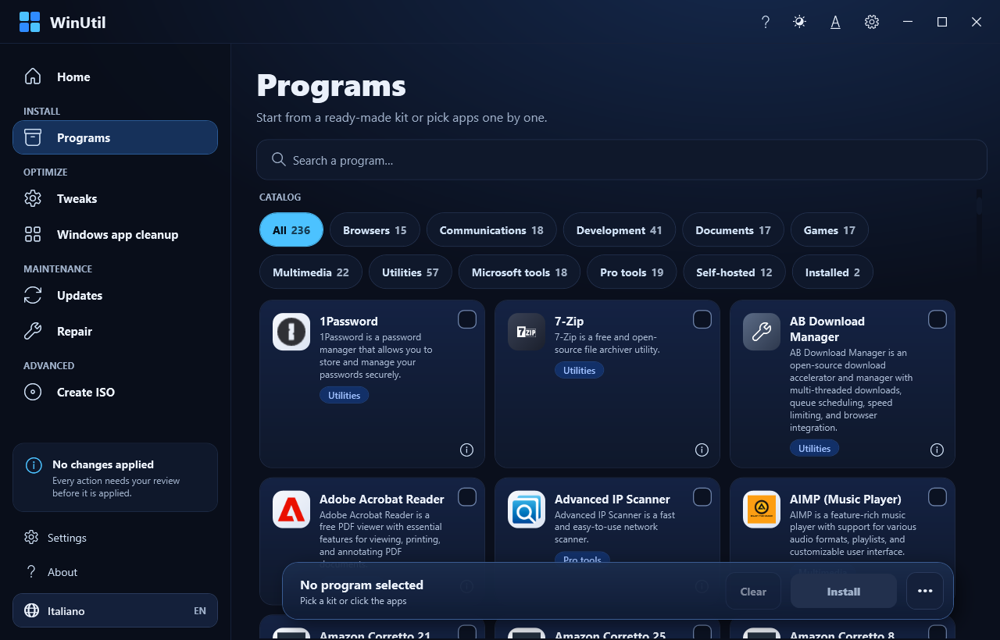 |

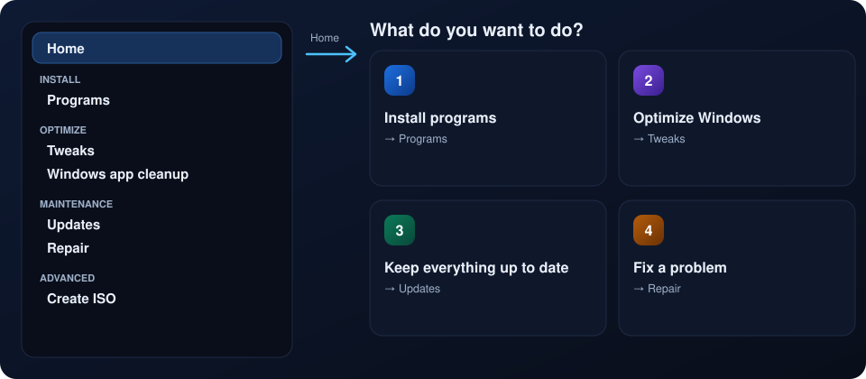

### Programs

Pick a kit or click programs one by one; the bar at the bottom counts the selection and installs it. The "Installed" chip and the badge on each card show what is already on the PC (read from the package manager that is in use).

| Italiano | English |
|---|---|
| 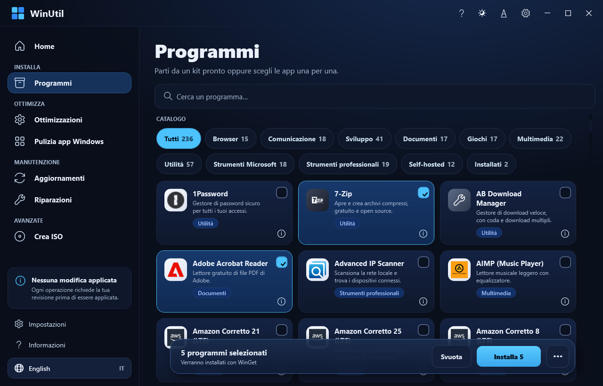 | 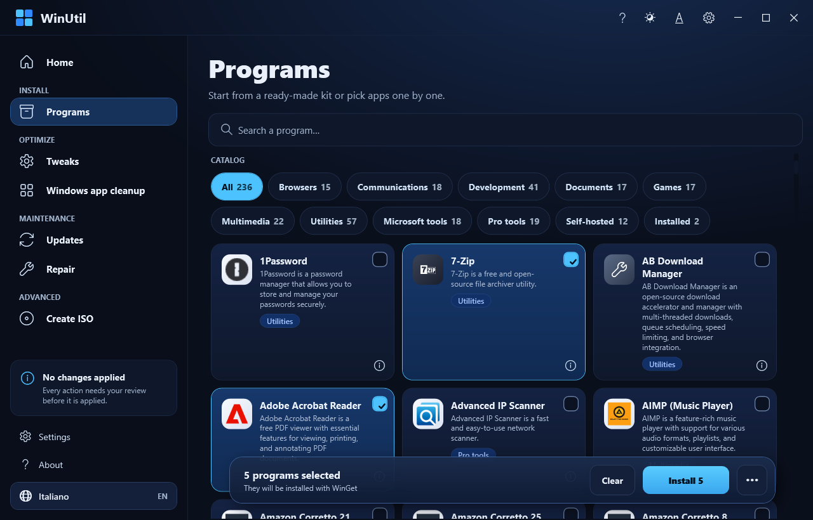 |

The ⓘ button of a card opens the details on the right: description, category, the WinGet and Chocolatey IDs, license (when the catalog marks the program as open source), website, and the button that adds or removes it from the selection.

| Italiano | English |
|---|---|
| 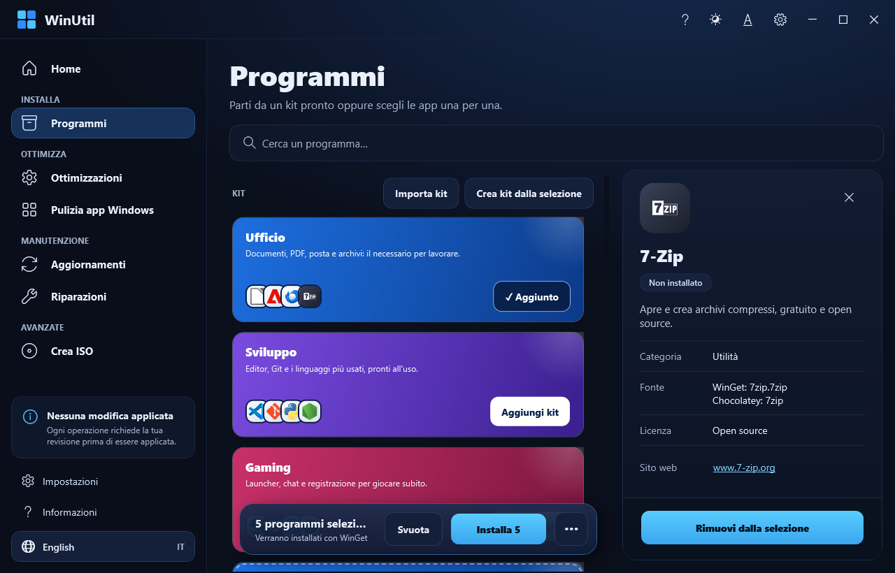 |  |

While it installs, the bar shows the step the engine reports and a percentage (the step text comes from the engine, in English):

| Italiano | English |
|---|---|
| 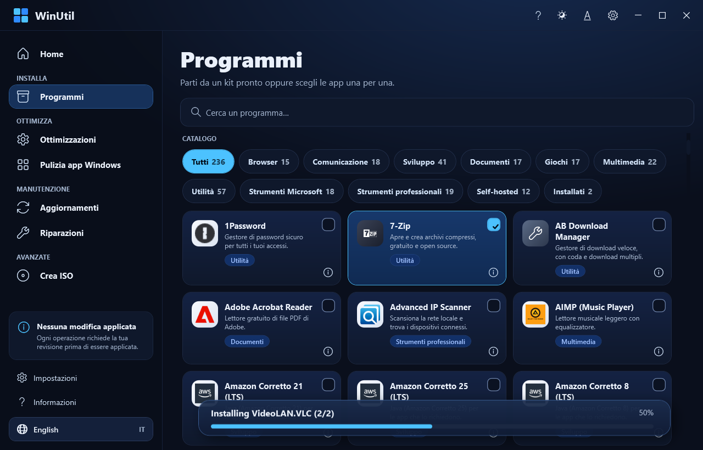 | 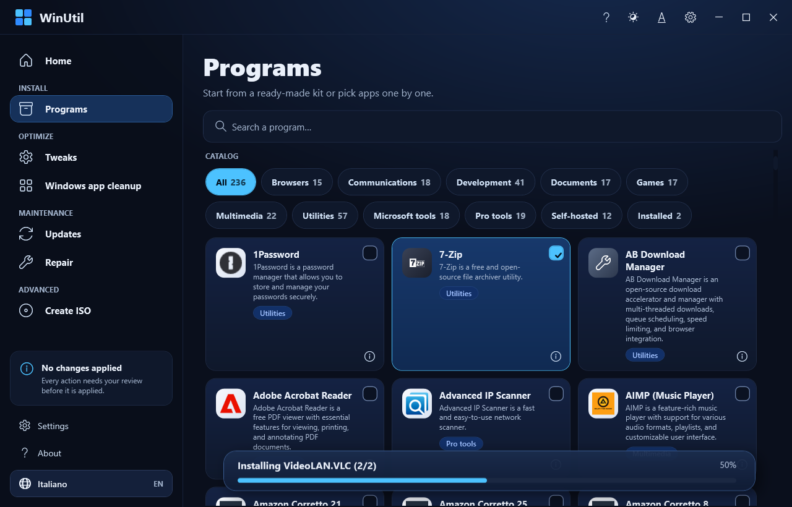 |

The "⋯" menu holds what used to be a fixed column: uninstall the selection, upgrade all programs, select the installed ones, and the choice between WinGet and Chocolatey.

### Icons

Every program shows its own icon. In this order: the icon the program's **official web page** declares (downloaded in the background into `%LOCALAPPDATA%\WinUtil\icons`, never blocking the window, and shown from that cache when there is no network); a **brand outline** from [Simple Icons](https://simpleicons.org/) (CC0) on a tile of the brand's color; a **generic glyph of the category**. Sources and licenses are in [docs/ICONS.md](docs/ICONS.md).

### Tweaks

The Tweaks tab, with cards, filter chips and the "Before you apply" panel, now inside the grouped sidebar.

| Italiano | English |
|---|---|
| 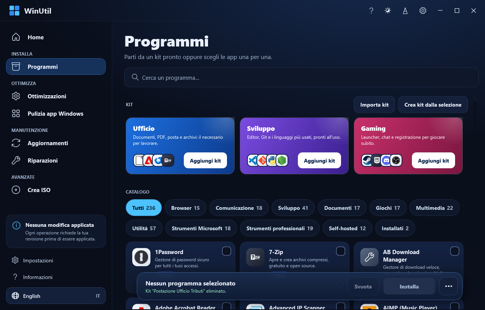 |  |
|  |  |
| 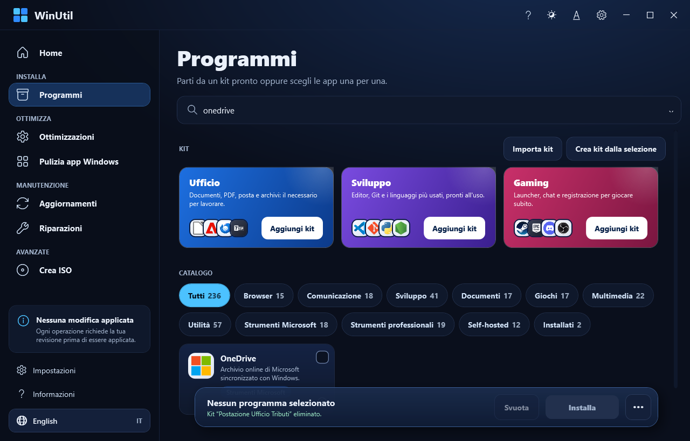 | 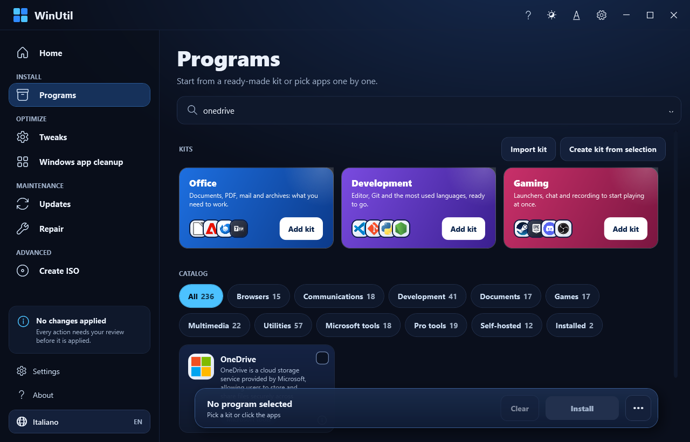 |
|  | 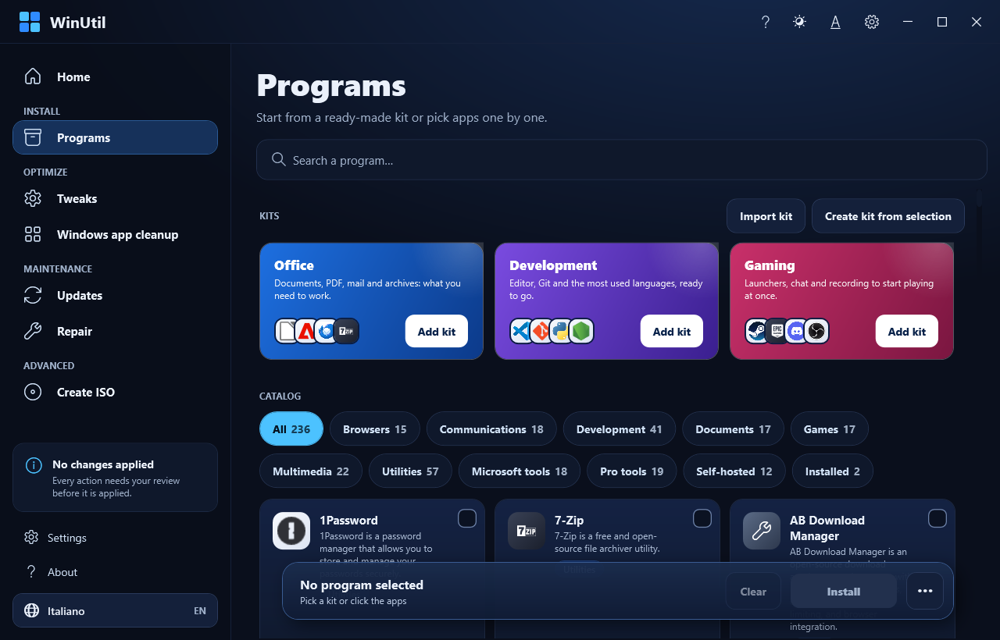 |

*Recommended* means the tweak is in upstream's Standard preset; *Advanced* means it is in upstream's "CAUTION" category or is a risky change of its own. Whether a tweak can be undone is read from its own data, not typed by hand. Switches, buttons and the Multiplane Overlay list apply immediately as upstream does and appear under "Other settings"; the DNS list is applied with the Apply button.

## Custom kits

A **kit** is a named list of programs. Three come with WinUtil (Office, Development, Gaming); you can make your own and carry them between PCs.

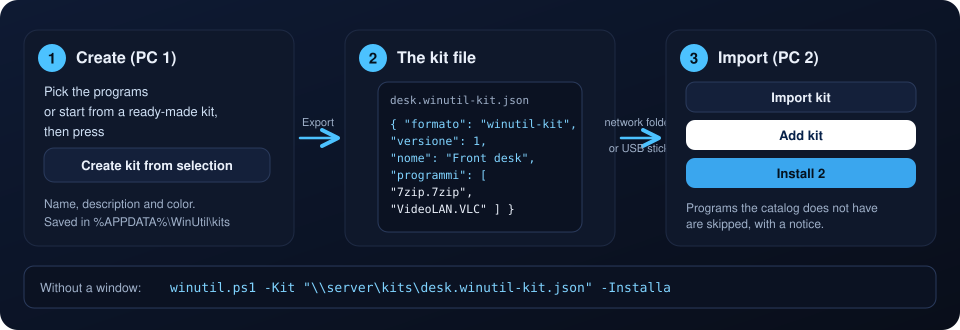

| Italiano | English |
|---|---|
| 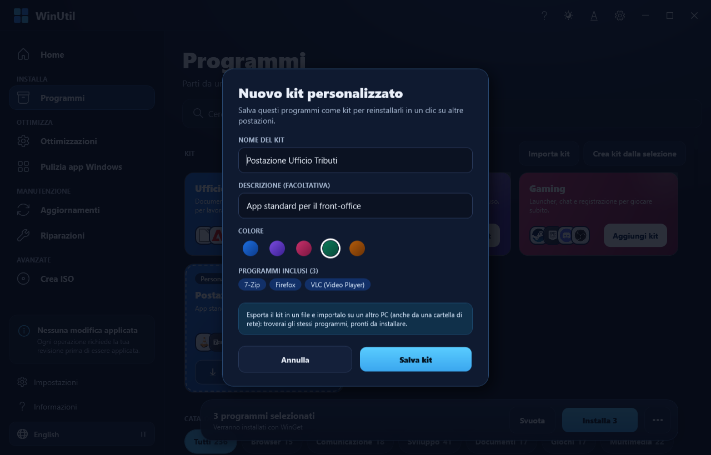 | 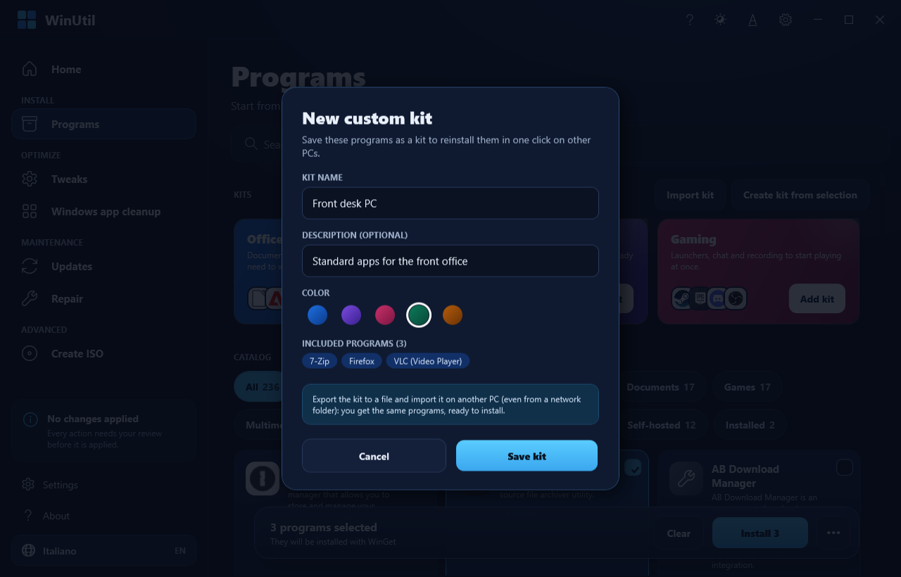 |
| 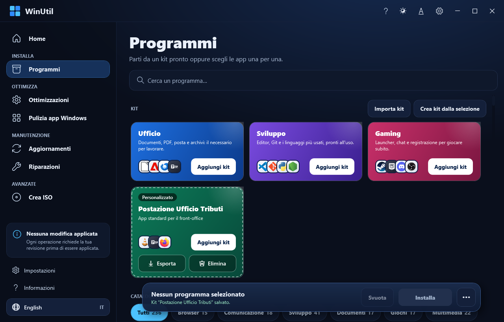 | 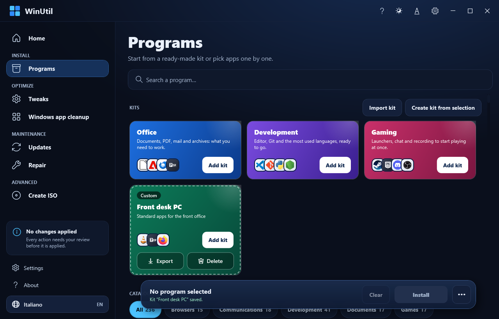 |

- **Add kit** puts the kit's programs in the selection; "✓ Added" takes them out again.
- **Create kit from selection**: a name (required), a description (optional), one of five colors. It is saved in `%APPDATA%\WinUtil\kits` and shows among the kits with the tag *Custom*, plus **Export** and **Delete** buttons.
- **Export** asks where to save `name.winutil-kit.json` (a network folder is fine). **Import kit** reads such a file, checks it and adds the kit; programs the catalog does not have are skipped and the message says how many.

The file holds **package IDs**, never display names, so it means the same thing on every PC:

```json
{
  "formato": "winutil-kit",
  "versione": 1,
  "nome": "Front desk PC",
  "descrizione": "Standard apps for the front office",
  "programmi": [
    "7zip.7zip",
    "VideoLAN.VLC",
    "Mozilla.Firefox"
  ]
}
```

(`formato`, `versione`, `nome`, `descrizione` and `programmi` are the names of the fields: format, version, name, description and programs.) The ID is the WinGet ID of the program, or its Chocolatey ID when it has no WinGet one; a kit made on a PC with a newer catalog still imports here.

### Install a kit from the command line

For workstations, with no window. The command is for the redesigned build and needs `winutil.ps1` as a file (download it from the [releases](https://github.com/realfulvio/winutil/releases/latest) or compile it):

```powershell
# Show what the kit holds and what would be skipped. Nothing is installed.
powershell -ExecutionPolicy Bypass -File .\winutil.ps1 -Kit "\\server\kits\front-desk.winutil-kit.json"

# Install it silently, one program at a time, then report
powershell -ExecutionPolicy Bypass -File .\winutil.ps1 -Kit "\\server\kits\front-desk.winutil-kit.json" -Installa
```

It relaunches as Administrator if needed (a UAC prompt) and waits for the result. Exit code **0** is success, **1** a kit that cannot be read or an installation with problems, **2** `-Installa` without `-Kit`. Messages are in the language of Windows. The package manager is WinGet. The usual log is in `%LOCALAPPDATA%\winutil\logs`.

## What changed

- `ui/redesign/`: the new window, its styles, the dictionary (`strings.json`), the program catalog extras (`programs.json`), the brand outlines (`icons.json`) and the runtime code. See [SPEC.md](SPEC.md) and the architecture page of the docs.
- `Compile.ps1`: the `-Interface Redesign` switch (the default build is unchanged). The redesign build also gets the `-Kit` and `-Installa` parameters, added at compile time.
- Wrapped upstream functions: `Initialize-WinUtilTabContent`, `Find-TweaksByNameOrDescription`, `Invoke-WinUtilFontScaling`, `Find-AppsByNameOrDescription` and `Invoke-WPFTab` (upstream's version is renamed `<Name>Upstream` and still does the work).
- Install, uninstall and upgrade are upstream's own buttons and functions, driven by the new window.

## Project status

Checked in this release, on a Windows 11 Enterprise LTSC virtual machine with Windows PowerShell 5.1, with the compiled redesign build:

- The real window was driven through its real controls (63 checks, all passed): Home and its four cards, the sidebar, the catalog (236 cards), category chips, search, selection, the action bar, the three built-in kits, the details panel, creating, saving, exporting, importing and deleting a custom kit, the invalid and partly unknown kit files, the package manager menu, and the Italian/English switch. No error was logged.
- **7-Zip and VLC were really installed and then uninstalled with WinGet** through the window (24 checks, all passed), including the progress bar, the "Installed" marks refreshing and the catalog being disabled while a job runs.
- The command line mode (15 checks, all passed): a dry run, an invalid and a missing kit, `-Installa` without a kit, and a real install of a kit with an unknown program in it.
- Icons: 202 of the 236 cards show the program's own icon downloaded from its official site, 15 a brand outline and 19 the category glyph; with the network unreachable the same 202 are shown from the cache, and a network that was down did not mark any program as having no icon.
- `Compile.ps1` builds both variants and the redesign script parses; the new Pester tests (kits, icons, the adapter) pass. The whole suite on Windows PowerShell 5.1 gives 928 passed and 11 failed; the 11 are upstream's WinOneShot tests, which use `ConvertFrom-Json -NoEnumerate` (PowerShell 7 only) and have nothing to do with this change.

Not checked: the Chocolatey path from end to end (only switching to it), PowerShell 7 on this machine (the repository's CI runs the suite there), other Windows versions, high-DPI screens and other window sizes, the real open/save dialogs of Export and Import (the same functions were run with explicit paths), upstream's own confirmation window of Uninstall (answered by the test), and the Tweaks tab's Apply and Undo in this release (they were exercised on a real PC in the earlier release, on two user-level registry tweaks). Tweaks that run scripts, stop services or write to `HKLM`, and the restore point, were never tried with the interface. The screenshots are renders of the window made from the running program, not captures of a desktop. Details are in [`NOTE-LAVORO.md`](NOTE-LAVORO.md).

## Go back to the original interface

> **Upstream's command, not this fork's.** It starts the official, unmodified WinUtil:
>
> ```powershell
> irm https://christitus.com/win | iex
> ```

Or build this repository without the switch: `.\Compile.ps1 -Run`.

## Warning

**Tweaks and installs change your system**: the registry, services, installed components and programs. Not all changes can be undone and some need a restart. Create a **restore point** before you apply anything (the *Restore point* tweak does it) and read each description first. **You use this at your own risk**; the software is provided as is, without warranty.

## Credits and license

The engine, the tweaks, the app list and the original interface are the work of **[Chris Titus Tech](https://github.com/ChrisTitusTech)** and the contributors of [ChrisTitusTech/winutil](https://github.com/ChrisTitusTech/winutil); see its [contributors](https://github.com/ChrisTitusTech/winutil/graphs/contributors) and the [official documentation](https://winutil.christitus.com/). This fork keeps the upstream license: [MIT](LICENSE), copyright (c) 2022 CT Tech Group LLC. Brand names and logos belong to their owners; see [docs/ICONS.md](docs/ICONS.md).

---

# About the upstream project

*The rest of this page is upstream's README, kept as it is. Its commands run the official, unmodified WinUtil, not this fork's interface.*

# Chris Titus Tech's Windows Utility

[](https://github.com/ChrisTitusTech/winutil/releases/latest)

[](https://discord.gg/RUbZUZyByQ)

A curated compilation of Windows system tasks streamline **installs**, debloat with **tweaks**, troubleshoot with **config**, and configure **Windows updates**. Run it fresh on every new Windows install.


---

## Quick Start

> **WinUtil must be run as Administrator** because it performs system-wide changes.

Open PowerShell or Terminal as admin, then run:

**Stable Branch (recommended)**
```ps1
irm https://christitus.com/win | iex
```

**Development Branch**
```ps1
irm https://christitus.com/windev | iex
```

### How to open an admin terminal

- **Start menu:** Right-click Start → *Windows PowerShell (Admin)* or *Terminal (Admin)*
- **Search:** Press the `Windows key`, and type `PowerShell` or `Terminal`, then `Ctrl + Shift + Enter`

---

## Automation / Presets

Apply a predefined configuration without manual selection:

```powershell
& ([ScriptBlock]::Create((irm https://christitus.com/win))) -Preset Standard
```

| Preset | Description |
|--------|-------------|
| `Standard` | Balanced defaults for most users |
| `Minimal` | Minimal changes to suit every user |
| `Advanced` | Deep tweaks for power users |

To view exactly what each preset does, see:
https://github.com/ChrisTitusTech/winutil/blob/main/config/preset.json

---

## Build & Develop

See https://github.com/ChrisTitusTech/winutil/blob/main/.github/CONTRIBUTING.md

---

## Resources

- [Official Documentation](https://winutil.christitus.com/)
- [YouTube Tutorial](https://www.youtube.com/watch?v=6UQZ5oQg8XA)
- [ChrisTitus.com Article](https://christitus.com/windows-tool/)
- [Known Issues](https://winutil.christitus.com/knownissues/)
- [Report an Issue](https://github.com/ChrisTitusTech/winutil/issues)

---

## Support

- Leave a ⭐ to show support!
- Faster Dotnet Implementation for sale here: https://www.cttstore.com/windows-toolbox

## Sponsors

These are the sponsors that help keep this project alive with monthly contributions.

<!-- sponsors --><a href="https://github.com/dwelfusius"></a><a href="https://github.com/mews-se"></a><a href="https://github.com/jdiegmueller"></a><a href="https://github.com/robertsandrock"></a><a href="https://github.com/paulsheets"></a><a href="https://github.com/djones369"></a><a href="https://github.com/anthonymendez"></a><a href="https://github.com/FatBastard0"></a><a href="https://github.com/DursleyGuy"></a><a href="https://github.com/DwayneTheRockLobster1"></a><a href="https://github.com/KieraKujisawa"></a><a href="https://github.com/seanh1995"></a><a href="https://github.com/josencarnacao"></a><!-- sponsors -->

*<sub>Sponsors with a recurring subscription also get access to the .NET alternative.</sub>

---

## Contributors

[](https://github.com/ChrisTitusTech/winutil/graphs/contributors)

Thanks to everyone who has contributed time and effort to this project. Keep rocking 🍻
